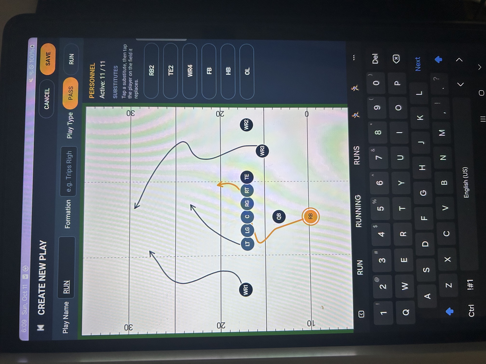
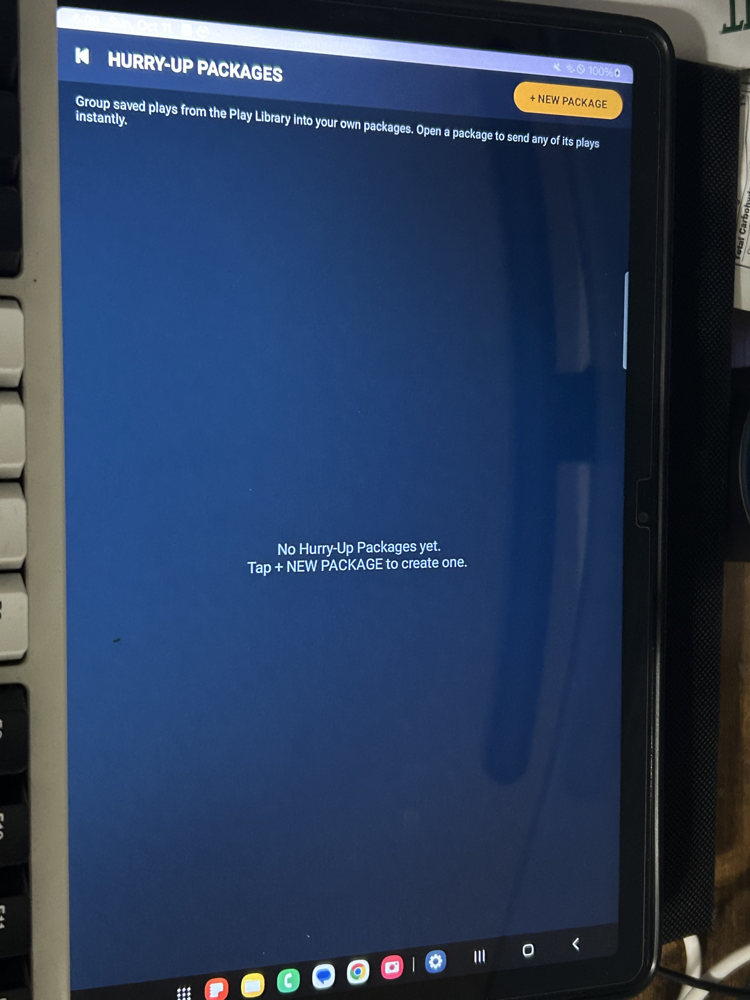

# GridSync – User Manual
**Version:** 1.0
**Team Name:** Cloud9
**Date:** 10/08/2026
 
---
 
## 1. Introduction
GridSync is a sports communication application designed to improve how coaches deliver both offensive and defensive plays during practices and simulated game situations. Instead of relying on verbal communication or printed play sheets, coaches will be able to select a play on a tablet and instantly send individualized assignments to players through Android wearable devices. The goal of the project is to build a working prototype that demonstrates structured one way communication over a controlled local network. 
 
---
 
## 2. System Requirements
- **Hardware:** Android tablet, Android watches, and a local Wi-Fi router
- **Software:** Android OS, Android Studio, and Kotlin or Java
---
 
## 3. Installation Guide
**Step 1:** Download/Clone the repository.

**Step 2:** Use Android Studio to download the app.

---

 
## 4. Getting Started
1. Make sure that both the tablet and the watches are on the same Wifi.
2. Launch the application on the coach's tablet.
3. Launch the application on the player's watch.
4. Navigate to the "Assign Watches" Button on the tablet.
5. Wait until the watch appears on the screen as connected.
 
---
 
## 5. Features & Functions
 
### Feature 1: Play Creation & Management
This feature allows the coach to create, store, edit, and select offensive or defensive plays directly on the Android tablet, assigning role-specific responsibilities to each player position.

- Navigate to the Create Play screen from the main menu.
- Enter the play name in the text field.
- 

 
### Feature 2: Hurry-Up Play Package
Groups two or more frequently used plays into a quick-access package, enabling the coach to select and transmit a prepared set of plays via a single control in under 2 seconds during no-huddle situations.

- Navigate to the Hurry-Up Package screen from the main menu.
- Select two or more saved plays from your Play Library to bundle together.
- When the Coach needs to instantly send a play, they only need to press a single button.

### Feature 3: Quarterback Full Play View
Designates one connected smartwatch as the Quarterback so that only that specific watch receives and displays the complete play formation, while all other watches continue to display only their individual role-specific assignments.

---
 
## 6. Troubleshooting

| Problem | Possible cause | Solution |
| --- | --- | --- |
| Watch does not appear on the tablet | Devices are on different networks or the watch app is closed | Connect both devices to the same Wi-Fi network and open GridSync on both devices. |
| Watch shows Unassigned | No player role has been assigned | Open Assign Watches on the tablet. Tap the watch and select its player role. |
| Player does not receive a play | Watch is disconnected or its role is incorrect | Check the connection and assigned role in Assign Watches. Then resend the play. |
| Quarterback does not see the full formation | Watch is not assigned QB or a text message was sent | Assign the QB role to the watch and send a saved play from the Play Library. |
| Play will not save | Play name is missing or the formation is invalid | Enter a play name and correct any issues shown in the warning message. |
| Hurry-Up package cannot be created | Fewer than two saved plays are selected | Select at least two saved plays and enter a unique package name. |
| Coach message will not send | Message is empty or no roles are selected | Enter a message and select at least one connected player role. |
| Deleted play is missing | Play was moved to Trash | Open Trash and restore the play if it has not been permanently deleted. |

---

## 7. Contact Information

| Team Member | Support Email |
| --- | --- |
| Haley Kang | HaleyKang@my.unt.edu |
| Raj Shakya | RajShakya@my.unt.edu |
| Kunsang Gurung | KunsangGurung@my.unt.edu |
| Solomon Legesse | SolomonLegesse@my.unt.edu |
| Esemfon Edet | esemfonedetedet@my.unt.edu |

**Project Repository**

[GridSync on GitHub](https://github.com/UNT-Capstone-Team-9/GridSync)

---

## 8. FAQ

### Q1. Do the tablet and watches need internet access?
**Answer**  
No. GridSync communicates over a local Wi-Fi network. The tablet and watches must be connected to the same network.

### Q2. Does every player see the entire play?
**Answer**  
No. The QB watch displays the full formation. Other assigned watches display their individual player information.

### Q3. How many plays are required for a Hurry-Up package?
**Answer**  
There is no minimum number of plays required. The coach can add plays from the Play Library as needed.

### Q4. Does a Hurry-Up package send all its plays at once?
**Answer**  
No. Open the package and send the individual play you want players to receive.

### Q5. Does deleting a package delete its saved plays?
**Answer**  
No. The plays remain in the Play Library.

### Q6. Can I recover a deleted play?
**Answer**  
Yes if the play is still in Trash. Permanently deleted plays cannot be restored from Trash.

### Q7. Do players need Android Studio?
**Answer**  
No. Players only need the installed GridSync app.

### Q8. Does a send notification mean the player read the play?
**Answer**  
No. Check the watch to confirm that the play appeared. GridSync does not provide a player read confirmation.
